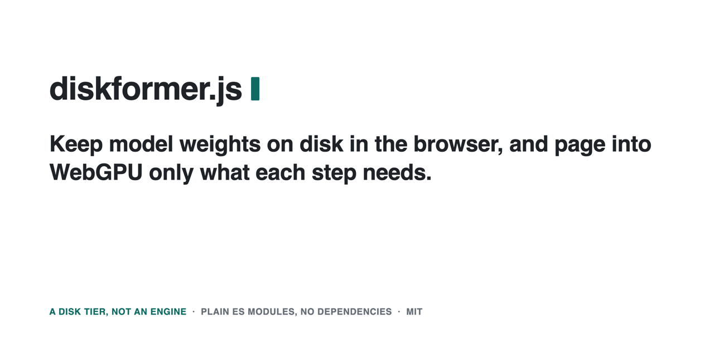

<h1 align="center">diskformer.js</h1>

**Run a mixture-of-experts model larger than your GPU memory in a browser tab, from one import.** llama.cpp runs on
WebGPU in a worker; the GGUF stays on disk in the browser's private storage (OPFS), and only the experts each token
needs are paged into GPU memory. 17 architectures are checked against llama.cpp, from Qwen3.6 35B to gpt-oss 20B.

Plain ES modules, no dependencies, no build step. Chrome or Edge with WebGPU, on any origin (CDN or self-hosted).
Weights stay in the user's own browser storage. The disk tier underneath (`src/`) also runs two hand-written engines.

[](https://www.npmjs.com/package/diskformer)
[](LICENSE)
[](package.json)

[](https://diskformer.naklitechie.com/)

## Install

| How | Command |
|---|---|
| npm | `npm install diskformer` |
| CDN | `import { Llama } from 'https://cdn.jsdelivr.net/npm/diskformer@0.5.4/ggml/llama.js'` |
| Copy | `src/`, `engines/` and `index.js`; nothing else is needed |

## Quick start

Paste into any page served over http(s), in Chrome or Edge. The first run downloads the 4.2 GB GGUF from Hugging Face into
OPFS (resumable); later loads take seconds. Any MoE GGUF on a [checked architecture](docs/coverage.md) loads the same way.
```html
<script type="module">
import { Llama } from 'https://cdn.jsdelivr.net/npm/diskformer@0.5.4/ggml/llama.js';
const llama = new Llama();
const name = 'granite-4.0-h-tiny-Q4_K_M.gguf';
await llama.download({ name, size: 4230976352,
  url: `https://huggingface.co/ibm-granite/granite-4.0-h-tiny-GGUF/resolve/main/${name}` });
await llama.load({ name, budget: 3e9 });                     // GPU memory in bytes; the rest pages in from OPFS
const { text } = await llama.chat([{ role: 'user', content: 'Name three primary colours.' }]);
console.log(text);
</script>
```
`download` takes a progress callback, `chat` an `onPiece` callback for streaming, and `abort()` stops either.

## Try it: an 80B model (48 GB file) in under 5 GB of GPU memory

https://github.com/user-attachments/assets/4a23b43e-995a-4ba8-b1df-5ffae0222b4e

[diskformer.naklitechie.com](https://diskformer.naklitechie.com/) (also a [Hugging Face Space](https://huggingface.co/spaces/naklitechie/diskformer-chat))
runs llama.cpp's WebGPU backend with the experts paged in from OPFS (source in `ggml/`). Pick a model; it downloads
once. Measured in Chrome on a MacBook Pro M4 Pro, 24 GB, 2026-10-13 (the recording above):

| Model (GGUF) | On disk | GPU memory | Decode | Paged vs unpaged replies |
|---|---|---|---|---|
| Qwen3-Next 80B-A3B, Q4_K_M | 48.4 GB | 4.89 GB | 2.9 tok/s, 359 MB read per token | 9/9 identical (16 vs 64 slots) |
| OLMoE 1B-7B, Q4_K_M | 4.21 GB | 3.92 GB | 22.4 tok/s | 9/9 identical |
| LFM2 8B-A1B, Q4_K_M | 5.04 GB | 3.89 GB | 17.1 tok/s | 9/9 identical |

17 architectures pass both checks (paging exact natively, then Chrome against llama.cpp): Gemma 4, Qwen3, Qwen3-Next, Qwen3.6,
Qwen3-VL, GLM-4.7-Flash, Nemotron 3, ERNIE 4.5, gpt-oss, North, LFM2/2.5, Mellum2, Ling 2.0/3.0, Granite 4.0 H, OLMoE, Flint. [docs/coverage.md](docs/coverage.md).

## Why

Your model does not fit on the GPU, or fits only by crowding out everything else. Browser engines load every weight
at load time, though a mixture-of-experts model uses under a tenth of its weights per token. diskformer keeps those
weights in OPFS, read through sync access handles in workers, and moves only what each step needs into a GPU cache.

## The engines

The disk tier also stands alone: your engine keeps its own kernels and decides what a step needs. `engines/` holds three
from-scratch WebGPU engines on it: Gemma 4 26B-A4B, Qwen3.6 35B-A3B and Qwen3-30B-A3B (at
[/classic/](https://diskformer.naklitechie.com/classic/); `Gemma4MoeSsd.load(null, { gpuBudgetBytes })`). A budget that
cannot hold the dense part and two tokens' experts is refused with the numbers. Kernels: gemma4-webgpu (Apache-2.0,
`engines/NOTICE`). Measured on a MacBook M4 Pro, 24 GB, Chrome 154, 2026-10-05, decode the median of
`node examples/run-demo.mjs chat --budget <GB>`:

| Model | On disk | GPU memory used | Decode | Output |
|---|---|---|---|---|
| Gemma 4 26B-A4B, QAT Q4_0 | 14.4 GB | 2.02 GB (budget 2.5) | 12.4 tok/s | 9/9 replies identical to llama.cpp b9830 Metal |
| Gemma 4 26B-A4B, QAT Q4_0 | 14.4 GB | 6.63 GB (budget 7) | 17.9 tok/s | 9/9 |
| Qwen3.6 35B-A3B, Q8_0 | 36.9 GB | 3.52 GB (budget 4) | 9.2 tok/s | not compared (does not fit Metal here) |

"Identical": character for character on the same GGUF, 9 conversations, greedy, 64 tokens. Only Apple silicon is
tested; discrete GPUs and 8–16 GB machines are not.

## A table on disk

`RowFile` holds fixed-size rows in one OPFS file with a manifest, written once and validated by a fingerprint.
`RowCache` keeps `slots` rows on the GPU, split into planes when a row's parts live in different buffers, with an
O(1) LRU and an optional GPU id→slot map that kernels can read. `examples/embedding` is the whole loop in one page.

## Experts on disk

`ingestGguf({ url, key, plan })` streams a GGUF over HTTP ranges into OPFS in your engine's layout: `plan.layout` says
where each tensor goes, `plan.units` the byte ranges to copy or split (Q8_0 and Q4_0 blocks become a value plane and an
f16-scale plane, bit-exact). It resumes from its last 1 GiB checkpoint. For a GGUF already on disk, pass a picked `File`
as `fetch: fileFetch(file)`: no download, same store. `ExpertStreamer` (also `RecordPool`) keeps a fixed GPU slot pool
of expert records: `ensure(layer, ids)` returns pinned slots, `prefetch(layer, guesses)` never blocks, and uploads go
through a mapped staging ring.

`listStores()` lists the stored models with size and state; a store with zero-byte or short files (a crash) is
`invalid` and is ingested again, never loaded. `removeStore(key)` removes one and keeps the rest. Errors carry a `code`
(`LOAD_ABORTED`, `BUDGET_TOO_SMALL`, … in `src/errors.js`), checked with `isDiskformerError(e, code)`. `measure({ path, recordBytes })` reports OPFS read speed.

## Commands

```bash
npm test                                     # Node unit tests: record pool, row cache, GGUF parse and splits, ingest helpers
node examples/run-demo.mjs rows              # headless Chrome: a 64 MB table on disk, 2,048 rows on the GPU, every byte checked
node examples/run-demo.mjs embedding         # lookup → slots → a WGSL gather kernel, every output value checked
node examples/run-demo.mjs chat --budget 2.5 # downloads Gemma once (14.4 GB) to a fixed profile, replays 9 llama.cpp replies, fails on any difference
node examples/run-demo.mjs test/browser/<page>.html --models <dir> --file <gguf>   # ingest resume, token-by-token, per-layer checks
npm run sync                                 # the files shared with LocalMind match their sources
```

The chat gate replays `examples/chat/refs/gemma.json` (llama.cpp's replies) under a GPU budget; any differing reply
exits 1. `--models <dir>` serves a local GGUF; `--site <url>` gates a deployed copy, such as the Space.

## License

MIT. `engines/` contains kernels ported from Apache-2.0 code: see `engines/NOTICE`. Model weights are not distributed;
each model downloads under its own terms. The code runs in [LocalMind](https://github.com/NakliTechie/LocalMind) (`src/` and `engines/` are its copies) · `CHANGELOG.md`.
